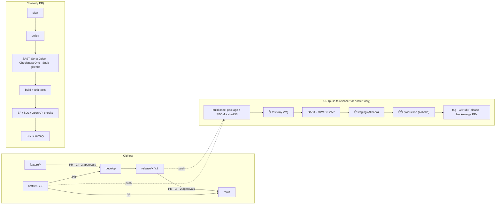

# pipeline-templates

Dynamic, reusable **GitHub Actions CI/CD templates** for every component type of the platform:
ABP/.NET backend APIs, Angular web front-ends, SQL Server databases, AI/VLM Python services and the
Integration API. A repository describes its components once in `pipeline.yml`; the templates do the rest.

## What is in here

| Path | Purpose |
|---|---|
| `.github/workflows/ci-component.yml` | reusable CI: plan → policy → SAST → build/test → type checks → **`CI / Summary`** |
| `.github/workflows/cd-component.yml` | reusable CD: build once → test → staging → production → release bookkeeping |
| `.github/workflows/deploy-stage.yml` | one stage: approval → per component runner tasks → host tasks → post tasks → DAST |
| `.github/workflows/rollback.yml` | reusable manual rollback |
| `actions/plan` | reads `pipeline.yml` + `types/*.yml`, builds the matrices, computes the version |
| `actions/package` | builds the immutable release package (`<name>-<version>.tar.gz` + `.sha256`) |
| `actions/deploy` | DB backup, EF migrations / SQL scripts, rolling install via `app-deploy`, smoke + contract tests |
| `actions/dast` | OWASP ZAP baseline (web) or API scan (OpenAPI) |
| `types/*.yml` | **component types** – what CI runs and which deploy tasks apply (see table below) |
| `scripts/server/app-deploy` | root helper on every server: releases/current symlink, systemd, Nginx, health, auto-rollback |
| `scripts/prepare-server-ubuntu2404.sh` | prepares an Ubuntu 24.04 server for its roles |
| `scripts/install-runner.sh` | installs a self-hosted runner (my VM now, Alibaba runners later) |
| `scripts/setup-repo.sh` | Git Flow branches, rulesets (2 approvals), environments, variables of a consumer repo |
| `scripts/rename-owner.sh` | points all `uses:` references at your fork/owner |
| `rulesets/*.json` | branch/tag protection imported by `setup-repo.sh` |
| `examples/*` | ready-to-copy `pipeline.yml` + workflows for each repository |
| `samples/integration-api` | complete sample Integration API (.NET 10) using the `integration-api` type |
| `docs/` | [ROLLOUT](docs/ROLLOUT.md) · [PIPELINE-YML](docs/PIPELINE-YML.md) · [SECRETS](docs/SECRETS.md) · [TOOLS](docs/TOOLS.md) · [RUNBOOK](docs/RUNBOOK.md) |

## Component types → tasks

| Type | CI build / SAST | Extra CI checks | Server role | Runner tasks (deploy runner) | Host tasks (each server) | Post tasks | DAST |
|---|---|---|---|---|---|---|---|
| `backend-dotnet` | dotnet · Sonar · Checkmarx · Snyk | EF destructive-migration guard | api | **DB backup**, migrations (DbMigrator) | install, health, auto-rollback | smoke | ZAP API |
| `integration-api` | dotnet · Sonar · Checkmarx · Snyk | OpenAPI breaking-change gate (+ EF) | integration | DB backup, migrations (if it owns a DB) | install, health | smoke, contract smoke | ZAP API |
| `frontend-angular` | ng build/test · Sonar JS · Snyk | – | web | – | install (Nginx static), health | smoke | ZAP baseline |
| `database` | SQL naming lint | NNN_*.sql order | db | **DB backup**, **run pending DB scripts** | – | DB verify | – |
| `ai-service` | pytest · Sonar Python · Snyk | – | ai | – | install (venv + systemd), health | smoke | ZAP API |

Adding a new kind of component = adding one `types/<type>.yml`; no workflow changes.

## Environments

| Environment | Where | Runner labels | Approval |
|---|---|---|---|
| CI | my Ubuntu VM (self-hosted) – or GitHub-hosted | `self-hosted, linux, ci` | – |
| test | my Ubuntu VM (runner + all roles, `DEPLOY_MODE=local`) | `self-hosted, linux, env-test` | test approvers (1) |
| staging | Alibaba Cloud ECS, Ubuntu 24.04 (`DEPLOY_MODE=ssh`) | `self-hosted, linux, env-staging` | staging approvers |
| production | Alibaba Cloud ECS, Ubuntu 24.04 (`DEPLOY_MODE=ssh`) | `self-hosted, linux, env-production` | production approvers (2) |

## Quick start

1. Push this repository as `<owner>/pipeline-templates`, run `scripts/rename-owner.sh <owner>` if the owner
   is not `mmamdouhDevops`, and tag `v1`.
2. Copy `examples/<repo>/` into each application repository (pipeline.yml + `.github/`).
3. `scripts/setup-repo.sh --repo <owner>/<repo> --approvers-test … --approvers-staging … --approvers-production …`
4. Prepare servers with `scripts/prepare-server-ubuntu2404.sh`, register runners with `scripts/install-runner.sh`.
5. Fill the variables/secrets listed by `setup-repo.sh` ([SECRETS](docs/SECRETS.md)), open a PR, cut `release/1.0.0`.

Full walkthrough: **[docs/ROLLOUT.md](docs/ROLLOUT.md)**.
